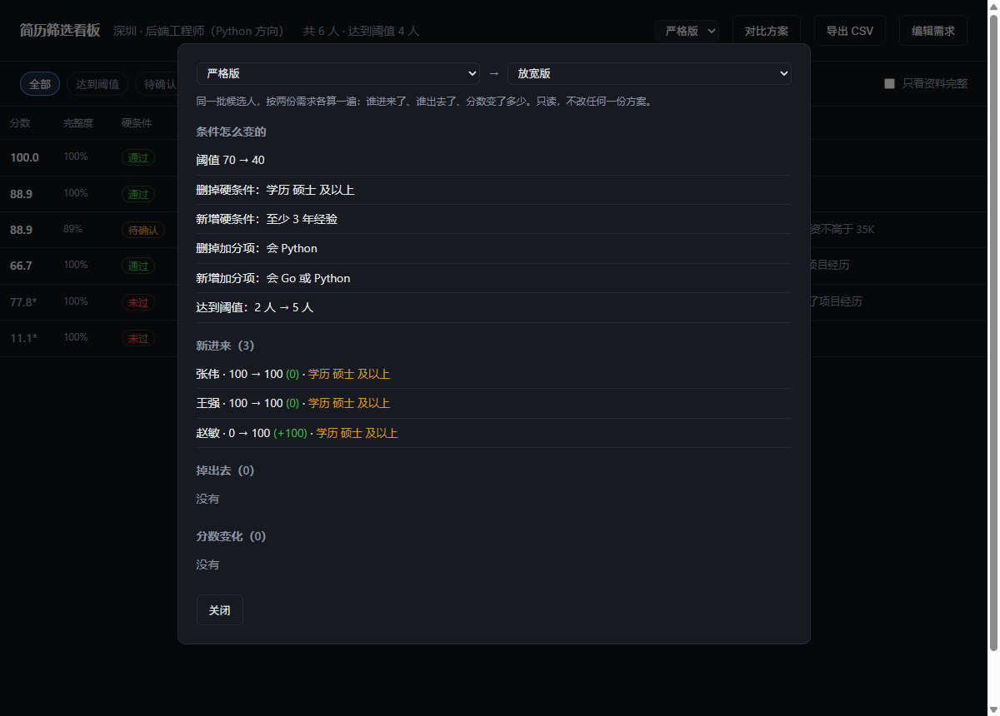
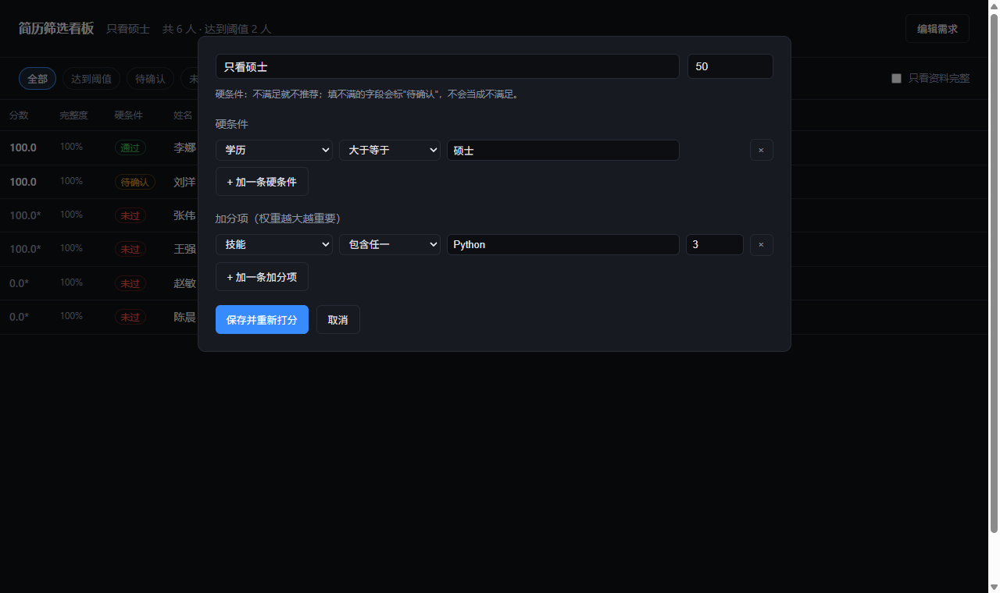
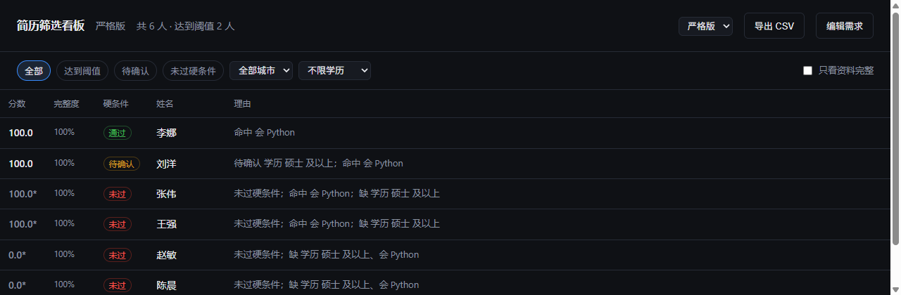
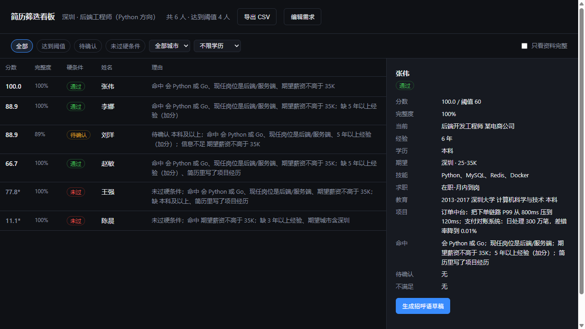

# boss-screening

只读的招聘端简历筛选工具。**不打招呼、不发消息、不碰任何付费动作。**

它只做一件事：把**主动投递到你职位**的候选人，按你自己写的需求打分排序，出一份名单和理由。

> 定位：个人老板 / 小团队的本地筛选器。不接 ATS，不上传数据，不代发消息。

## 校准选择器（有招聘号之后）

BOSS 前端改版会换类名，所以选择器全在 `config/selectors.boss.json` 里，代码里没有。改完用体检命令逐项核对：

```bash
bosscreen check --kind list   --page "<投递列表 URL>"    # 容器有没有命中、几条、每个字段命中几个
bosscreen check --kind detail --page "<在线简历 URL>"
```

全 ✓ 之后再把 `calibrated` 改成 `true`，否则 `collect` 会拒绝上真机（猜错的选择器会被当成事实）。

## 它做什么

```
读取投递列表（滚到底，把懒加载的候选人一起收）→ 打开在线简历 → 结构化 → 按需求打分 → 出名单 + 理由 + 草稿
```

全链路零付费：列表、简历、打分都在本地完成。

## 它不做什么（明确边界）

| 不做 | 原因 |
|---|---|
| 打招呼 / 回复 / 发消息 | BOSS 招聘端发消息要付费，且属于对外动作 |
| 索要附件简历 / 换电话 / 换微信 / 面试邀请 | 均为付费"请求"，V1 一律不碰 |
| 推荐牛人 / 搜索牛人 | 属于"主动找牛人"路线，后续版本再议 |
| 绕过验证码、模拟人类行为规避风控 | 明确不做 |

## 对比两份需求

「先严格筛一遍，再放宽看看」是老板的常见动作，所以看板可以直接比：



`对比方案` 面板会告诉你：阈值和条件怎么变了、达到阈值的人从几个变成几个、
谁进来了谁出去了（附上「卡在哪条硬条件」）、谁的分数动了。整个对比是只读的，不改任何一份需求。

命令行也能看：

```bash
python -m bosscreen.cli diff --a 严格版 --b 放宽版
```

## 状态

**早期开发中。** 整条链路已经在样例页面上跑通；**真实页面的选择器还没校准**（开发时没有企业招聘账号）。

这意味着：`collect` 会先看 `calibrated` 标志，未校准直接拒绝——不会拿猜测的选择器去真机上乱抓。
有账号之后的校准步骤写在 [docs/state.md](docs/state.md#有账号之后)，就是"填选择器 + 打开开关"两件事。

## 快速开始

```bash
python -m bosscreen.cli demo          # 用内置样例跑一遍：解析 → 打分 → 打印名单
python -m bosscreen.cli serve --mock  # 打开本地看板 http://127.0.0.1:8686/
python -m bosscreen.cli doctor        # 自检：配置、浏览器、选择器
```

不需要浏览器、不需要账号、不联网（`doctor` 和 `collect` 除外，它们只连你本机已开着的 Chrome）。

想验证"从页面取数"这条路，用自带样例页面跑一遍（仍然只读、不联网）：

```bash
# 先起一个带调试端口的 Chrome
chrome.exe --headless=new --remote-debugging-port=9334 --user-data-dir=%TEMP%\cdptest
python -m bosscreen.cli collect --fixture --selectors tests/fixtures/selectors.fixture.json --port 9334
```

也可以 `pip install -e .` 后用 `bosscreen demo`。注意这一步要联网拉 setuptools；
离线机器直接用 `python -m bosscreen` 即可，功能完全一样。


看板里点任意一行看完整信息；点"生成招呼语草稿"只把文本算出来给你复制——
**发不发、发给谁，仍然由你在 BOSS 里手动决定。**

右上角"编辑需求"可以直接改条件：硬条件、加分项、权重、阈值，保存后立刻重新打分。
不用去翻 JSON——但改完会同时写进本地库和你的需求文件，下次打开还是这份需求。



需求可以存多份，用右上角的下拉切换：比如"严格版"先筛一遍，再切到"放宽版"看看差点什么。
改名保存就是另存为新方案，同名保存就是覆盖。切方案只重算、不写库。

名单可以导出成 CSV（右上角"导出 CSV"，或 `bosscreen export`）：
UTF-8 带 BOM，Excel 直接打开不乱码；简历里没有的字段留空，不填 0。



点开一个人能看到他的求职状态、教育经历、项目经历——项目是老板真筛人时最先看的，
所以它在详情面板里、也在导出的表里。



## 文档

- [需求与验收](docs/spec.md)
- [决策记录](docs/decisions.md)
- [当前进度](docs/state.md)
- [模块与数据结构](docs/interfaces.md)

## 合规

- 简历数据只存本地 SQLite，不上传、不导出、不用于训练
- 平台对简历信息有明确要求："仅可出于自身招聘的目的"使用，本工具按此设计
- 使用本工具产生的账号风险由使用者自行承担，作者不提供任何规避平台风控的手段

## 许可

MIT
