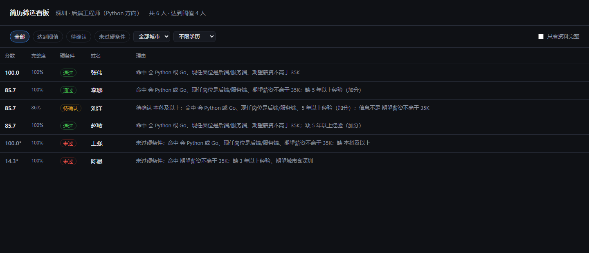

# boss-screening

只读的招聘端简历筛选工具。**不打招呼、不发消息、不碰任何付费动作。**

它只做一件事：把**主动投递到你职位**的候选人，按你自己写的需求打分排序，出一份名单和理由。

> 定位：个人老板 / 小团队的本地筛选器。不接 ATS，不上传数据，不代发消息。

## 它做什么

```
读取投递列表 → 打开在线简历 → 结构化 → 按需求打分 → 出名单 + 理由 + 草稿
```

全链路零付费：列表、简历、打分都在本地完成。

## 它不做什么（明确边界）

| 不做 | 原因 |
|---|---|
| 打招呼 / 回复 / 发消息 | BOSS 招聘端发消息要付费，且属于对外动作 |
| 索要附件简历 / 换电话 / 换微信 / 面试邀请 | 均为付费"请求"，V1 一律不碰 |
| 推荐牛人 / 搜索牛人 | 属于"主动找牛人"路线，后续版本再议 |
| 绕过验证码、模拟人类行为规避风控 | 明确不做 |

## 状态

**早期开发中。** 采集层尚未在真实招聘账号上校准（开发时无可用账号），当前版本可以在 mock 数据上跑通完整链路。

## 快速开始

```bash
python -m bosscreen.cli demo          # 用内置样例跑一遍：解析 → 打分 → 打印名单
python -m bosscreen.cli serve --mock  # 打开本地看板 http://127.0.0.1:8686/
python -m bosscreen.cli doctor        # 自检：配置、浏览器、选择器
```

不需要浏览器、不需要账号、不联网（`doctor` 除外，它只连你本机已开着的 Chrome）。

也可以 `pip install -e .` 后用 `bosscreen demo`。注意这一步要联网拉 setuptools；
离线机器直接用 `python -m bosscreen` 即可，功能完全一样。



看板里点任意一行看完整信息；点"生成招呼语草稿"只把文本算出来给你复制——
**发不发、发给谁，仍然由你在 BOSS 里手动决定。**

## 文档

- [需求与验收](docs/spec.md)
- [决策记录](docs/decisions.md)
- [当前进度](docs/state.md)
- [模块与数据结构](docs/interfaces.md)

## 合规

- 简历数据只存本地 SQLite，不上传、不导出、不用于训练
- 平台对简历信息有明确要求："仅可出于自身招聘的目的"使用，本工具按此设计
- 使用本工具产生的账号风险由使用者自行承担，作者不提供任何规避平台风控的手段

## 许可

MIT
